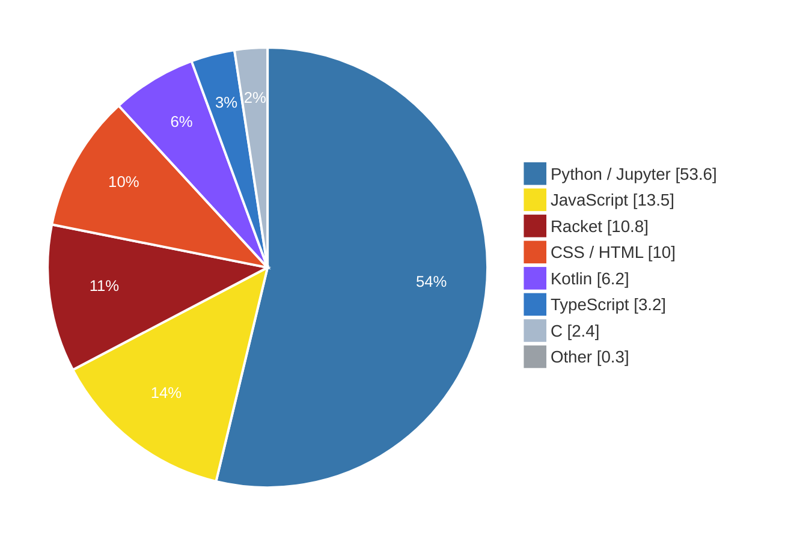

<h1 align="center">Hyeonbin Jung</h1>

  <b>Computer Science & Mathematics @ Columbia University</b> 
  Machine learning for finance · Quantitative research · Software engineering 
  Founder, <a href="https://extriver.com">Extriver Partners</a>

  
  
  

---

## 💻 Languages

<b>Code by language</b> Share of code across all of my public repositories

  
  
  
  
  
  
  

<b>🧰 Also working with</b>

   
  C++ &nbsp;·&nbsp; Rust &nbsp;·&nbsp; OCaml &nbsp;·&nbsp; R &nbsp;·&nbsp; SQL &nbsp;·&nbsp; Shell

---

## 🧠 Machine Learning & Data

   
  <b>PyTorch</b> &nbsp;·&nbsp; <b>TensorFlow</b> &nbsp;·&nbsp; <b>scikit-learn</b>

<table>
  <tr>
    <td width="190" valign="top"><b>🔬 Modeling libraries</b></td>
    <td>
      
      
      
      
      
      
      
      
      
      
      
    </td>
  </tr>
  <tr>
    <td width="190" valign="top"><b>📐 ML models</b></td>
    <td>
      
      
      
      
      
      
      
      
      
      
      
      
      
      
      
      
      
    </td>
  </tr>
  <tr>
    <td width="190" valign="top"><b>🤖 LLMs & AI engineering</b></td>
    <td>
      
      
      
      
      
      
      
      
      
      
      
      
      
      
      
      
    </td>
  </tr>
  <tr>
    <td width="190" valign="top"><b>📈 Financial data</b></td>
    <td>
      
      
      
      
      
    </td>
  </tr>
  <tr>
    <td width="190" valign="top"><b>⚙️ MLOps & data</b></td>
    <td>
      
      
      
      
      
      
    </td>
  </tr>
  <tr>
    <td width="190" valign="top"><b>🧩 Application stack</b></td>
    <td>
      
      
      
      
      
      
    </td>
  </tr>
</table>

<table>
  <tr>
    <td width="33%" valign="top"><b>📐 Regularized regression</b> Ridge / Lasso / Elastic Net with CV, <code>Pipeline</code> + <code>StandardScaler</code></td>
    <td width="33%" valign="top"><b>⏱️ Leak-free validation</b> Chronological training and out-of-period testing to avoid look-ahead bias</td>
    <td width="33%" valign="top"><b>📊 Statistical testing</b> OLS with <code>statsmodels</code>, Spearman / Pearson correlation, curve fitting with <code>scipy.optimize</code></td>
  </tr>
  <tr>
    <td valign="top"><b>🧮 Factor models</b> Alternative-data signals as equity factors; multi-factor strategy fitting and backtesting</td>
    <td valign="top"><b>🛰️ LLM applications</b> RAG pipelines with vector search, LoRA / PEFT fine-tuning, real-time anomaly detection and research-grounded guidance</td>
    <td valign="top"><b>💹 Finance</b> DCF / FCFF · public comps · 3-statement & LBO · M&A diligence · EV-to-equity bridges</td>
  </tr>
</table>

---

## 🚀 Selected Projects

| Project | What it does | Stack |
|---|---|---|
| [**Automated-DCF-ML**](https://github.com/HyeonbinJung/Automated-DCF-ML) | Engineers SEC Company Facts / XBRL data and fits **Ridge & Elastic Net** forecasts for six value drivers (revenue growth, EBIT margin, tax, D&A, CapEx, NWC intensity); converts them to NOPAT and FCFF, then a DCF to enterprise / equity value and fair value per share. Chronological training (through 2018) and testing (2022+). | Python · scikit-learn · SciPy |
| [**InsightStream**](https://github.com/HyeonbinJung/InsightStream) ⭐ | DigitalOcean Gradient™ AI Hackathon — AI observability platform that streams logs through Kafka and uses Llama 3 to detect anomalies and summarize incidents in real time. | Kotlin · Spring Boot · Kafka · Next.js |
| [**Nanny Mira** — Child Temperament AI](https://github.com/HyeonbinJung/Child-Personality-Assessment-AI-Parenting-Advisor) | Parent-reported child temperament web app in **4 languages** (KO / EN / RU / PT-BR): an age-adapted 28-question assessment, 40 expandable analysis cards and **DeepSeek LLM** parenting guidance grounded with PubMed references; Prodamus card checkout. | Node.js · DeepSeek API · PubMed |
| [**Superdupercatai**](https://www.instagram.com/superdupercatai/) | AI comics & animation channel — AI-generated content production, growth and monetization analytics (**57.7K followers**). | Generative AI · content analytics |
| [**Extriver Partners**](https://extriver.com) | Product & business modeling — creator audience geography, engagement and sector demand to evaluate vertical-software concepts; subscription, conversion and revenue-share scenarios; internal partner pipeline and research-to-execution workspace. Distribution tested through an owned short-form account (**70K followers, 20M peak views, ~1M average views / video**). | Node.js · Socket.io · Cloudflare R2 |

---

## 💼 Experience

**Data Science Intern** — [Paratus Investment](https://www.paratusinvestment.com/) · Seoul · *Feb 2025 – Aug 2025*  
Reference &amp; Recommendation: [JungYeon (Andy) Kim](https://www.linkedin.com/in/jungyeon-andy-kim-90ab0a54), Vice President
- Screened 24 private-company targets using Capital IQ and 160+ listed peers; built LTM / NTM EV/Revenue, EV/EBITDA and P/E comp sets with growth, margin and size adjustments
- Automated peer selection, multiple refreshes and EV-to-equity bridges in Excel / xlwings / Python — **~40% fewer manual model updates**
- Built five-year FCFF / DCF cases with WACC, terminal-growth and exit-multiple methods; analyzed revenue, EBIT margin, CapEx and NWC sensitivities for transaction pricing

**Growth Capital Intern** — [Yuanta Investment](http://yuantainvest.com/) · Seoul · *Oct 2024 – Feb 2025*
- Valued private companies using 10–15 relevant public peers, normalized EBITDA and trading multiples; supported valuation exhibits and investment committee (IC) reports
- Built operating and LBO models for prospective investments, stress-testing entry / exit EV/EBITDA, debt paydown, leverage and sponsor IRR / MOIC under base and downside cases
- Assessed Sunbo Industrial bolt-on targets, pro forma EBITDA and synergies; automated daily deal / industry news clipping and EML-based macro signals for portfolio review

**FA Deal Advisory Intern** — [Deloitte Korea](https://www.deloitte.com/kr/ko.html) · Seoul · *Jan 2023 – Feb 2023*  
Reference &amp; Recommendation: [Sang-wook Nam](https://www.deloitte.com/kr/ko/about/people/profiles.sangnam+97cd9250.html), Managing Partner, Financial Advisory
- Supported buy-side medical-device M&A diligence, analyzing revenue concentration, normalized EBITDA, working-capital movement and cash-flow conversion
- Prepared peer screening and target comparisons; identified acquisition candidates with potential commercial synergies, financial risks and integration considerations

**Research Assistant** — [Paratus Investment](https://www.paratusinvestment.com/) · Seoul · *Jun 2022 – Sep 2022*
- Built manufacturing-sector DCF models linking volume, pricing, margins, CapEx and NWC to FCFF, discounted terminal value and implied equity value
- Standardized Excel valuation templates and automated research / market-news collection to update peer multiples, assumptions and deal-monitoring inputs

---

## 🎓 Education

<table>
  <tr>
    <td width="50%" valign="top">
       
      <b>Bachelor of Computer Science – Mathematics</b> 
      🎓 Minor in Statistics 
      📍 New York, NY &nbsp;·&nbsp; 🗓️ 2026 – Present  
      <b>Relevant coursework</b> 
       
      
    </td>
    <td width="50%" valign="top">
       
      <b>Bachelor of Computer Science</b> · <i>Cheriton School of Computer Science</i> 
      🎓 Minors in Combinatorics &amp; Optimization and Economics 
      📍 Ontario, Canada &nbsp;·&nbsp; 🗓️ Sep 2024 – Sep 2026  
      <b>Relevant coursework</b> 
       
       
       
       
       
       
       
       
        
      🎯 Combined GPA <b>3.53 / 4.00</b> (self-calculated) &nbsp;·&nbsp; ➕ External coursework 19 credits (UMass Global 13, BYU 6)
    </td>
  </tr>
</table>
